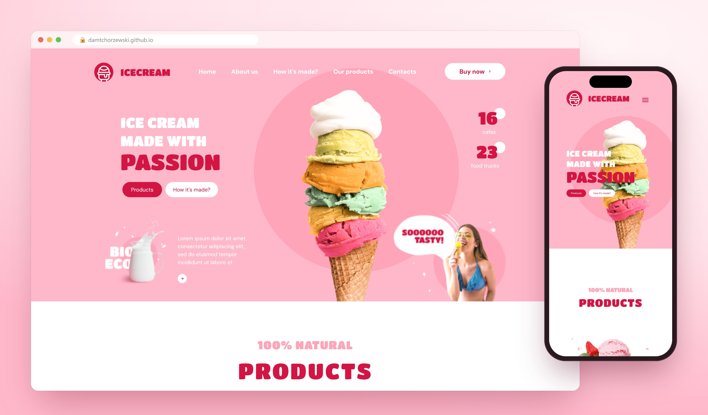
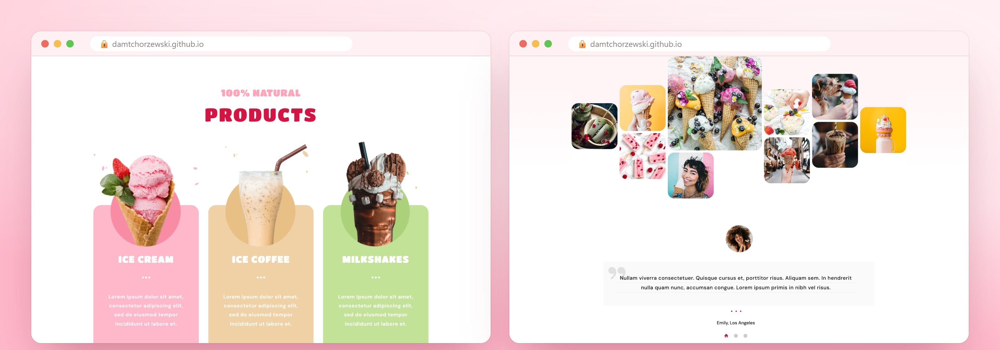
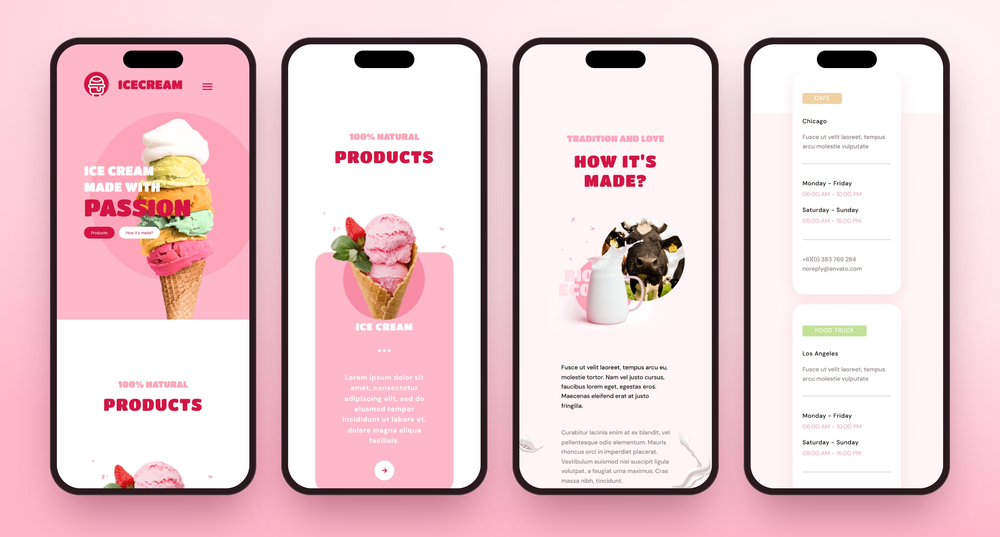

<p align="center">
  <picture>
    <source media="(prefers-color-scheme: dark)" srcset="docs/images/banner-dark.png">
    
  </picture>
</p>

<p align="center">
  
</p>

## About

<a href="https://damtchorzewski.github.io/ice-cream/"></a>

**IceCream Delights** is a responsive, mobile-first landing page for an ice-cream brand: a hero with a "Buy now"
call to action, the product range, the brand story, advantages, a photo gallery, customer reviews in a slider, and
the shops with their opening hours. It is a front-end exercise built from the GoIT Academy Parcel template.

- **Semantic HTML5 in partials.** The page is assembled from nine partials (`header`, `mobile-menu`, `products`,
  `about`, `advantages`, `gallery`, `reviews`, `contacts`, `footer`) with `posthtml-include`.
- **BEM and SASS.** Styles follow the BEM methodology and are written in SASS (18 files under `src/sass/`).
- **Mobile-first.** The layout is adjusted at 480 px, 768 px and 1200 px; images use `srcset` with `@1x` and `@2x`
  files.
- **Mobile menu.** A burger menu with a close button, the navigation and a "Buy now" button
  (`src/js/mobile-menu.js`).
- **Modals.** Product cards open "Learn more" windows and the contacts section opens the shop and franchise windows
  (`src/js/modal.js`).
- **Reviews slider.** Customer reviews run in a looped Swiper 8 slider with pagination, loaded from a CDN.
- **Deployed by Actions.** A push to `main` builds the site and publishes it with GitHub's Pages actions; a push to
  `develop` only checks that it builds.

> **Status:** a finished course project; the content (shops, reviews, prices) is sample content.

## Tech stack

|          |                                                                                                           |
| -------- | --------------------------------------------------------------------------------------------------------- |
| Stack    | HTML5, SASS, vanilla JavaScript; [Parcel 2](https://parceljs.org/) with `posthtml-include`, `modern-normalize` |
| UI       | BEM, mobile-first, Swiper 8 (CDN) for the reviews slider                                                  |
| Tests    | none                                                                                                      |
| Hosting  | GitHub Pages, published by GitHub Actions (Settings → Pages → Source: GitHub Actions)                     |

The content is in English; commits and branches are in English.

## Screenshots

<p align="center">
  
</p>
<p align="center">
  
</p>

## Quick start

```bash
git clone https://github.com/DamTchorzewski/ice-cream.git
cd ice-cream
npm install
npm start      # http://localhost:1234
```

Requirements: Node.js LTS and npm. Parcel reloads the page when a file changes.

## Scripts

| Command         | What it does                                                                       |
| --------------- | ---------------------------------------------------------------------------------- |
| `npm start`     | development server with live reload (`parcel src/*.html`)                          |
| `npm run build` | production build to `dist/` with the public URL `/ice-cream/` (what the workflow runs) |

## Configuration

None: no environment variables or keys. The public URL of the build is the `--public-url /ice-cream/` argument of
the `build` script and the `homepage` field in `package.json`; change both when the repository is renamed.

## Structure

```
src/index.html        ★ the page: includes the partials below
src/partials/         header, mobile-menu, products, about, advantages, gallery, reviews, contacts, footer
src/sass/             BEM blocks in SASS, compiled by Parcel
src/js/               modal.js (the modals), mobile-menu.js (open and close of the mobile menu)
src/index.js          empty entry module referenced by the page; the Swiper setup is inline in the reviews partial
src/images/           images with @1x / @2x variants and the favicon set
assets/               images of the Parcel template (not used by the page)
docs/                 documentation; docs/images/ holds the README images (generated, see below)
.github/workflows/    deploy.yml: build, and publish to GitHub Pages from main
```

## Branches and workflows

Shared standards from `reops/standards`: `main` ≤ `develop` ≤ a working branch `<type>/<topic>`, fast-forward
merges, Conventional Commits in English. `deploy.yml` builds every push to `main` and `develop` (not documentation-only ones) and publishes from `main` only;
there is no pause switch in the code (disable the workflow in GitHub to pause). Details: `reops/standards/workflows.md`, level 1.

**Departures from the standards (and why):**

- **No hooks, tests or Prettier/ESLint scripts:** a course exercise; `.prettierrc` is the template's.
- **README images** are made by `tools/readme-images` (profile `ice-cream`) from the live site; the logo is the site's
  own.
- **npm, not pnpm:** the Parcel template ships a `package-lock.json`.
- **Documentation:** the template's Polish `README.pl` (generic Parcel instructions) was removed; the Parcel
  documentation covers what it said.

## Documentation

| Document                                   | Covers                          |
| ------------------------------------------ | ------------------------------- |
| [docs/repository.md](docs/repository.md)   | GitHub description and topics   |

The README images (`docs/images/`) are regenerated with `tools/readme-images`, profile `ice-cream`; the working shots go
to `.scratch/`.

---

<p align="center"><a href="https://damreboot.pl"><picture><source media="(prefers-color-scheme: dark)" srcset="docs/images/damreboot/company-dark.svg"></picture></a><a href="https://www.linkedin.com/in/damian-tchorzewski-3b2388275/"><picture><source media="(prefers-color-scheme: dark)" srcset="docs/images/damreboot/linkedin-dark.svg"></picture></a><a href="mailto:damianchabracki@gmail.com"><picture><source media="(prefers-color-scheme: dark)" srcset="docs/images/damreboot/email-dark.svg"></picture></a></p>

<p align="center">
  <picture><source media="(prefers-color-scheme: dark)" srcset="docs/images/damreboot/engineered-dark.svg"></picture> Engineered by <b>Damian Chabracki</b> (DamReboot IT)
</p>
