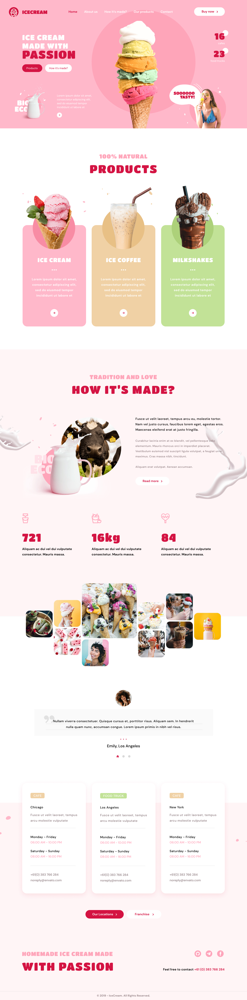

<p align="center">
  
</p>

## About

**Live site:** [damtchorzewski.github.io/IceCream](https://damtchorzewski.github.io/IceCream/)

**IceCream Delights** is a responsive, mobile-first landing page for an ice-cream brand: a hero with a "Buy now"
call to action, the product range, the brand story, advantages, a photo gallery, customer reviews in a slider, and
the shops with their opening hours. It is a front-end exercise built from the GoIT Academy Parcel template.

- **Semantic HTML5 in partials.** The page is assembled from nine partials (`header`, `mobile-menu`, `products`,
  `about`, `advantages`, `gallery`, `reviews`, `contacts`, `footer`) with `posthtml-include`.
- **BEM and SASS.** Styles follow the BEM methodology and are written in SASS (18 files under `src/sass/`).
- **Mobile-first.** The layout is adjusted at 480 px, 768 px and 1200 px; images use `srcset` with `@1x` and `@2x`
  files.
- **Mobile menu.** A burger menu with a close button, the navigation and a "Buy now" button
  (`src/js/mobile-menu.js`).
- **Modals.** Product cards open "Learn more" windows and the contacts section opens the shop and franchise windows
  (`src/js/modal.js`).
- **Reviews slider.** Customer reviews run in a looped Swiper 8 slider with pagination, loaded from a CDN.
- **Deployed by Actions.** Every push to `main` builds the site and publishes it to the `gh-pages` branch.

> **Status:** a finished course project; the content (shops, reviews, prices) is sample content.

## Tech stack

|          |                                                                                                           |
| -------- | --------------------------------------------------------------------------------------------------------- |
| Stack    | HTML5, SASS, vanilla JavaScript; [Parcel 2](https://parceljs.org/) with `posthtml-include`, `modern-normalize` |
| UI       | BEM, mobile-first, Swiper 8 (CDN) for the reviews slider                                                  |
| Tests    | none                                                                                                      |
| Hosting  | GitHub Pages (`gh-pages` branch) through GitHub Actions                                                   |

The content is in English; commits and branches are in English.

## Screenshots

<p align="center">
  
</p>

## Quick start

```bash
git clone https://github.com/DamTchorzewski/IceCream.git
cd IceCream
npm install
npm start      # http://localhost:1234
```

Requirements: Node.js LTS and npm. Parcel reloads the page when a file changes.

## Scripts

| Command         | What it does                                                                       |
| --------------- | ---------------------------------------------------------------------------------- |
| `npm start`     | development server with live reload (`parcel src/*.html`)                          |
| `npm run build` | production build to `dist/` with the public URL `/IceCream/` (what the workflow runs) |

## Configuration

None: no environment variables or keys. The public URL of the build is the `--public-url /IceCream/` argument of
the `build` script and the `homepage` field in `package.json`; change both when the repository is renamed.

## Structure

```
src/index.html        ★ the page: includes the partials below
src/partials/         header, mobile-menu, products, about, advantages, gallery, reviews, contacts, footer
src/sass/             BEM blocks in SASS, compiled by Parcel
src/js/               modal.js (the modals), mobile-menu.js (open and close of the mobile menu)
src/index.js          empty entry module referenced by the page; the Swiper setup is inline in the reviews partial
src/images/           images with @1x / @2x variants and the favicon set
assets/               images of the Parcel template (not used by the page)
docs/                 documentation and the screenshot used above
.github/workflows/    deploy.yml: build and publish to gh-pages
```

## Branches and workflows

Shared standards from `reops/standards`: `main` ≤ `develop` ≤ a working branch `<type>/<topic>`, fast-forward
merges, Conventional Commits in English. `deploy.yml` runs on every push to `main`.

**Departures from the standards (and why):**

- **Template metadata in `package.json`:** `author` and `repository` still point at the GoIT Academy template.
- **No banner, hooks, tests or Prettier/ESLint scripts:** a course exercise; `.prettierrc` is the template's.
- **npm, not pnpm:** the Parcel template ships a `package-lock.json`.
- **Workflow actions on old versions** (`checkout@v2.3.1`, `github-pages-deploy-action@4.1.0`), as in the template.
- **Documentation:** the template's Polish `README.pl` (generic Parcel instructions) was removed; the Parcel
  documentation covers what it said.

## Documentation

| Document                                   | Covers                          |
| ------------------------------------------ | ------------------------------- |
| [docs/repository.md](docs/repository.md)   | GitHub description and topics   |

---

Author: [Damian Tchorzewski](https://github.com/DamTchorzewski)
